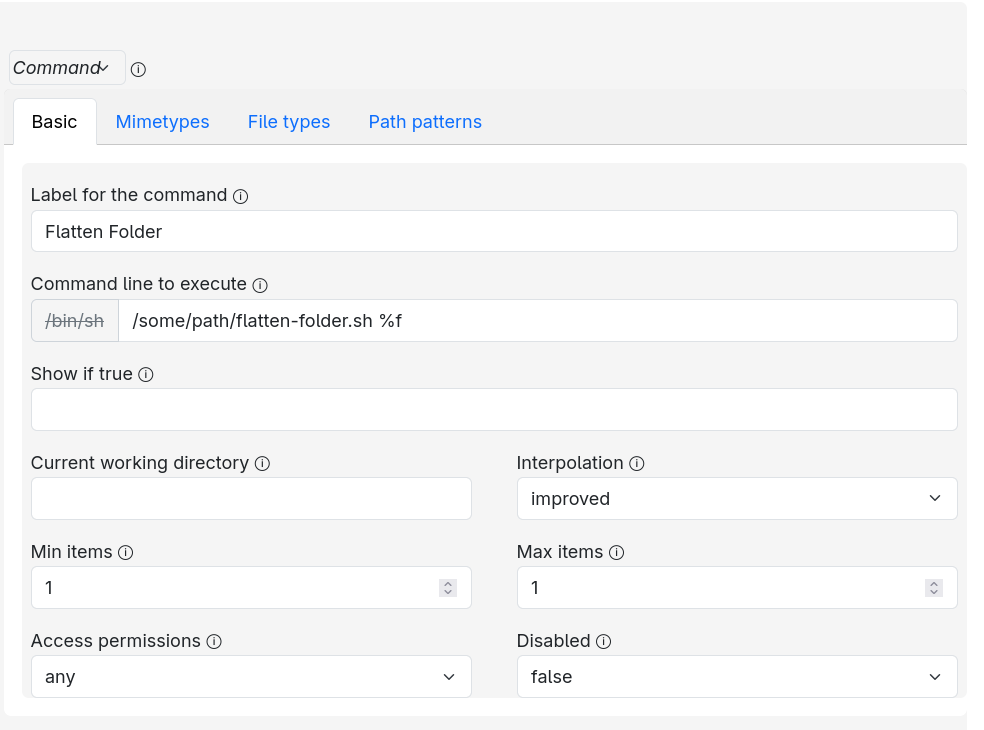
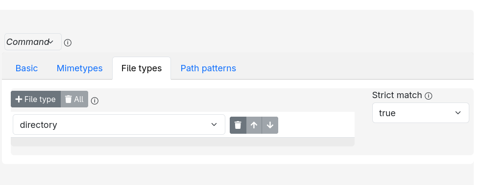

# folderFlattener-Linux

A Nautilus-only utility that moves every file below a selected directory into
that directory, prefixes each filename with its relative path, removes empty
directories, and deletes incomplete `.part` files.

## How It Works

Actions for Nautilus launches [flatten-folder.sh](flatten-folder.sh) and passes
the selected directory as its first argument. The script uses `gio move` and
`gio remove` rather than shell `mv` and `rm`, so the operations use the GLib/GIO
file-operation backend and also work with supported remote locations.

## Actions For Nautilus Configuration

Install [Actions for Nautilus](https://github.com/bassmanitram/actions-for-nautilus) first.
After that, download flatten-folder.sh and move it to the desired location.
Then open the Actions for Nautilus Configurator and create a new action with these values:

- **Basic > Label for the command:** `Flatten Folder`
- **Basic > Command line to execute:** `/absolute/path/to/folderFlattener/flatten-folder.sh %f`
- **Basic > Interpolation:** `improved`
- **Basic > Current working directory:** leave empty
- **Basic > Min items:** `1`
- **Basic > Max items:** `1`
- **File types > File type:** `directory`
- **Basic > Strict match:** `true`
- **Basic > Use shell:** leave disabled

Replace `/absolute/path/to/folderFlattener` with the real absolute path.
Make sure to include `%f` at the end of the command line, as it passes the selected directory to the script. The configuration should look roughly like this:




And in the json view, it should look like this:

```json
{
	"type": "command",
	"label": "Flatten Folder",
	"command_line": "/some/path/flatten-folder.sh %f",
	"max_items": 1,
	"use_v1_interpolation": false,
	"filetypes": ["directory"],
	"filetypes_strict_match": true
}
```

Save the configuration and restart Nautilus.

## Configuration

flatten-folder.sh can be configured to remove specific strings from the filenames. Edit the script and modify the `for string in ...` loop to include any strings you want to remove.

Requirements: Bash, `find`, `realpath`, GLib/GIO (`gio`), and Nautilus with
Actions.

See [LICENSE](LICENSE) for the license.
